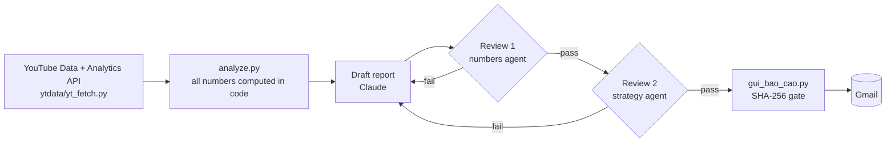

# analysis-social-media

A weekly **social-media analytics agent** for a one-person media studio: it pulls YouTube Analytics data for every channel, computes the numbers in code, has an AI write improvement proposals, and **only sends the report after it survives two rounds of independent AI review** (one for numbers, one for strategy).

> **How it was built:** I designed the process — what to measure, the two review gates, the rule that no number may appear unless code computed it — and run it every week. The code and the agent instructions were written together with **Claude Code (Anthropic's AI coding agent)**, with independent AI agents reviewing the work. The project shows how I direct AI agents to produce analysis I can trust.

## The problem
AI-written channel advice is often confident and wrong: invented numbers, wrong time zones, vague tips that cannot be measured. I wanted weekly advice that is **specific, measurable and checked** before it reaches me.

## How it works

| File | Role |
|---|---|
| `ytdata/yt_fetch.py` | OAuth per channel; pulls daily metrics, traffic sources and per-video stats (YouTube Data + Analytics APIs). Double-click `.bat` helpers for a non-programmer: install, add channel, fetch now, schedule (Mon/Fri). |
| `analyze.py` | Computes every figure the report may use (growth, watch time, subscribers, per-video comparisons). The report may not contain a number this script did not output. |
| `gui_bao_cao.py` | The **send gate**: sends only if the newest review file of **both** rounds says `KET_LUAN: DAT` (pass) **and** carries the SHA-256 of the exact final report — so nobody can edit the report after it was approved. |

## Lessons encoded in the process
- Time zones bite: YouTube Analytics days are Pacific Time, upload timestamps are UTC, the channel lives in Taiwan (UTC+8).
- Advice must name the metric that will prove it worked, and the date to check it.
- A review agent must be *new* each round and never see the other round's reasoning, to stay independent.
- Hard cap of 6 review calls per channel: if the draft still fails, it is not sent — a failed report is better than a wrong one.

## What is not in this repo
Channel list and goals (`kenh.md`), OAuth tokens, raw data and the reports themselves are private and git-ignored. The agent's step-by-step instructions live in a Claude Code skill (`/phan-tich-mxh`).

## Tech
Python 3.12, Google API client (YouTube Data v3, YouTube Analytics v2), OAuth 2.0, Claude Code agents + scheduled tasks, Windows Task Scheduler.

Code comments are in Vietnamese. License: MIT.
